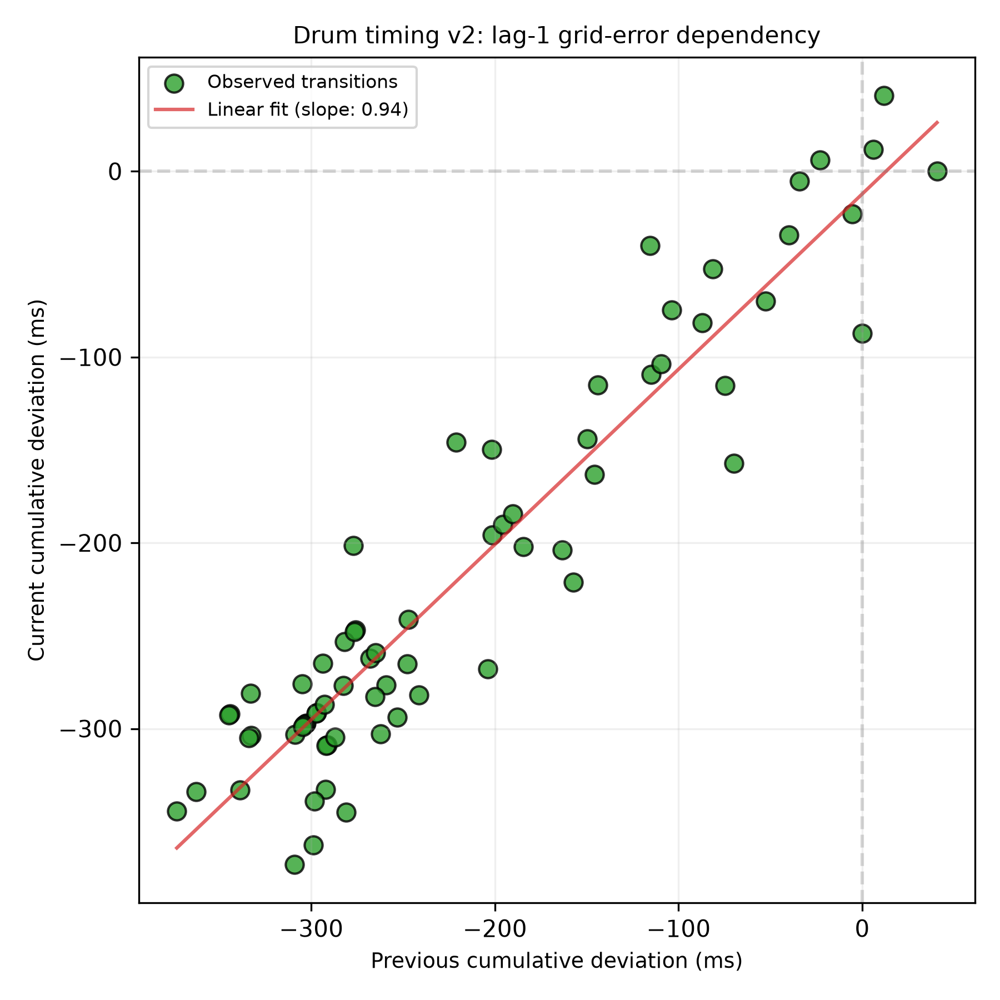

# Drum Timing Analysis

I started this project because I was curious about how consistent my timing actually was when playing the drums. Even when a rhythm sounds steady, I wondered how much the intervals between strikes might vary.

Instead of relying only on what I could hear, I decided to record a short drum sequence and look at the timing data myself.

## V1 — Static Grid Deviation

I recorded a roughly 22-second drum sequence and used Python's `librosa` library to detect the timestamps of individual strikes.

From these timestamps, I calculated the inter-onset intervals (IOIs) and their average duration. I then constructed a fixed timing grid using the first detected strike and the average IOI.

By comparing each strike with its corresponding position on this grid, I could track how the timing deviations accumulated throughout the recording.

The program detected 70 strikes, giving 69 inter-onset intervals with an average duration of 319.36 ms.

The cumulative timing deviations ranged from approximately −373 ms to +41 ms.


What interested me most was how the deviations changed over the course of the recording. Rather than staying close to zero, the curve moved substantially into negative values before returning toward the reference grid.

The grid was based on the recording's own average interval, so it describes changes relative to that average pace rather than accuracy against an external metronome.

## V2 — Lag-1 Grid-Error Dependency

After seeing the V1 curve, I wanted to find out whether consecutive timing deviations were related. If one strike was ahead of the reference grid, would the next strike tend to remain ahead?

V2 uses the same cumulative grid errors from V1, pairing each deviation with the one immediately following it. I calculated the Pearson correlation coefficient and fitted a straight line to examine the relationship between consecutive errors.

The analysis produced:

- **Detected strikes:** 70
- **Lag-1 correlation:** 0.9433
- **Naive Pearson p-value:** 8.2954 × 10⁻³⁴
- **Fitted slope:** 0.9433



The high correlation raised another question: how much of it came from the way the cumulative grid errors were constructed?

This became the starting point for V3, where I tested the relationship using simulated intervals and the IOIs themselves.

## Running the Code

Install the required Python packages:

```bash
pip install numpy librosa matplotlib scipy
```

Place `drum_take_01.wav` in the same working directory as the scripts.

Run V1:

```bash
python v1_drum_static_grid_deviation.py
```

Run V2:

```bash
python v2_drum_naive_error_dependency.py
```

Each script prints its statistics and saves a PNG plot in the working directory. The figures shown above are kept in the `figures/` folder.