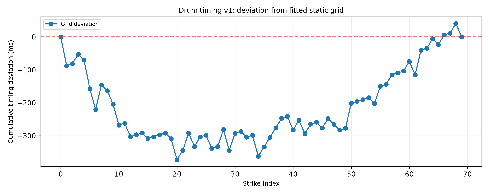
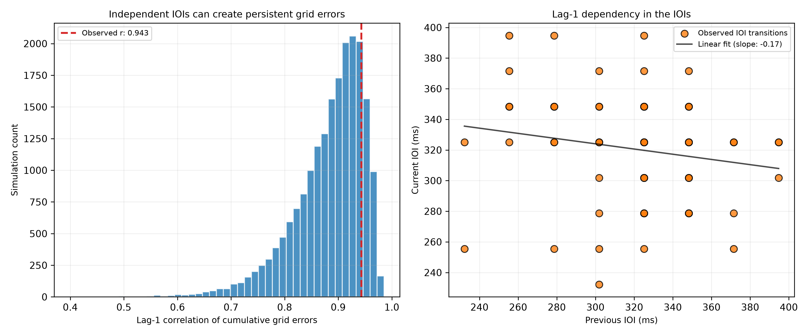
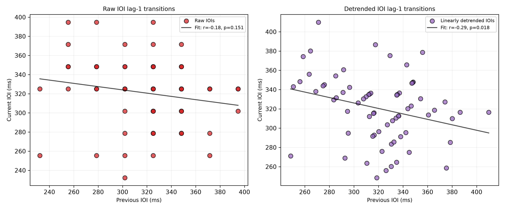

# Drum Timing Analysis

I started this project because I was curious about how consistent my timing actually was when playing the drums. Even when a rhythm sounds steady, I wondered how much the intervals between strikes might vary.

Instead of relying only on what I could hear, I decided to record a short drum sequence and look at the timing data myself.

## V1 — Static Grid Deviation

I recorded a roughly 22-second drum sequence and used Python's `librosa` library to detect the timestamps of individual strikes.

From these timestamps, I calculated the inter-onset intervals (IOIs) and their average duration. I then constructed a fixed timing grid using the first detected strike and the average IOI.

By comparing each strike with its corresponding position on this grid, I could track how the timing deviations accumulated throughout the recording.

The program detected 70 strikes, giving 69 inter-onset intervals with an average duration of 319.36 ms.

The cumulative timing deviations ranged from approximately −373 ms to +41 ms.



What interested me most was how the deviations changed over the course of the recording. Rather than staying close to zero, the curve moved substantially into negative values before returning toward the reference grid.

The grid was based on the recording's own average interval, so it describes changes relative to that average pace rather than accuracy against an external metronome.

## V2 — Lag-1 Grid-Error Dependency

After seeing the V1 curve, I wanted to find out whether consecutive timing deviations were related. If one strike was ahead of the reference grid, would the next strike tend to remain ahead?

V2 uses the same cumulative grid errors from V1, pairing each deviation with the one immediately following it. I calculated the Pearson correlation coefficient and fitted a straight line to examine the relationship between consecutive errors.

The analysis produced:

- **Detected strikes:** 70
- **Lag-1 correlation:** 0.9433
- **Naive Pearson p-value:** 8.2954 × 10⁻³⁴
- **Fitted slope:** 0.9433


The high correlation raised another question: how much of it came from the way the cumulative grid errors were constructed?

This became the starting point for V3, where I tested the relationship using simulated intervals and the IOIs themselves.

## V3 — IOI Construction Diagnostics

To investigate the high correlation from V2, I generated 20,000 sets of independent IOIs using a normal distribution with the same mean and standard deviation as my recording.

For each simulated sequence, I reconstructed the cumulative timing errors using the same method as V1 and V2, then calculated their lag-1 correlation.

The median simulated correlation was **0.8987**. In **15.84%** of the simulations, the correlation was at least as high as the observed value of 0.9433.

I also looked directly at the original IOIs rather than their cumulative deviations.

The results were:

- **Mean IOI:** 319.36 ms
- **IOI standard deviation:** 37.02 ms
- **IOI lag-1 correlation:** −0.1760
- **Pearson p-value:** 0.1511



The simulation showed that high correlations between cumulative grid errors can appear even when the underlying intervals are generated independently.

Looking at the IOIs themselves gave a much weaker relationship. I also fitted a linear trend to the intervals and found a slope of 0.5421 ms per strike (p = 0.0143), corresponding to an estimated increase of 36.86 ms across the recording.

These results made me more interested in the timing intervals themselves, especially how their variation might be explained beyond a simple correlation.

## V4 — Wing-Kristofferson Covariance Decomposition

V3 showed a weak negative lag-1 correlation in the raw IOIs, alongside a positive linear trend. In V4, I used the Wing-Kristofferson model to examine how lag-1 covariance contributes to the variance of the intervals, both before and after detrending.

Since V3 also showed a positive linear trend in the IOIs, I performed the decomposition on both the original intervals and a linearly detrended version.

For each series, I calculated the lag-0 variance and lag-1 covariance, then estimated the model-implied motor and clock variance components:

- **Motor variance:** −γ₁
- **Clock variance:** γ₀ + 2γ₁

The results were:

| Measure | Raw IOIs | Detrended IOIs |
| --- | ---: | ---: |
| Lag-0 variance (ms²) | 1350.35 | 1233.78 |
| Lag-1 covariance (ms²) | −224.82 | −333.69 |
| Lag-1 correlation | −0.1760 | −0.2851 |
| Pearson p-value | 0.1511 | 0.0184 |
| Model-implied motor variance (ms²) | 224.82 | 333.69 |
| Model-implied clock variance (ms²) | 900.72 | 566.40 |



I also checked the raw IOIs across the first six lags to see how their correlations and autocovariances changed beyond adjacent intervals.

| Lag | Correlation | Pearson p-value | Autocovariance (ms²) |
| ---: | ---: | ---: | ---: |
| 1 | −0.1760 | 0.1511 | −224.82 |
| 2 | −0.0864 | 0.4870 | −110.00 |
| 3 | 0.0407 | 0.7458 | 51.69 |
| 4 | 0.1090 | 0.3872 | 137.17 |
| 5 | 0.1809 | 0.1525 | 216.65 |
| 6 | 0.0768 | 0.5495 | 87.18 |

The decomposition changed after removing the fitted linear trend. The estimated motor component increased, while the clock component decreased.

V5 examines how changes in onset-detection resolution affect the detected IOIs and the resulting variance estimates.

## Running the Code

Install the required Python packages:

```bash
pip install numpy librosa matplotlib scipy
```

Place `drum_take_01.wav` in the same working directory as the scripts.

Run V1:

```bash
python v1_drum_static_grid_deviation.py
```

Run V2:

```bash
python v2_drum_naive_error_dependency.py
```

Run V3:

```bash
python v3_drum_ioi_construction_diagnostics.py
```

Run V4:

```bash
python v4_drum_wing_kristofferson_diagnostics.py
```

Each script prints its statistics and saves a PNG plot in the working directory. The figures shown above are kept in the `figures/` folder.